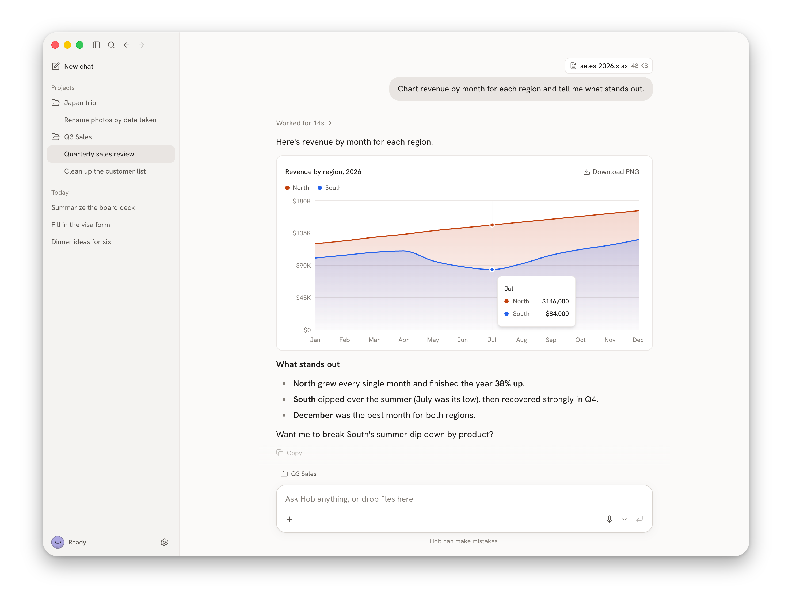

  

<h1 align="center">Hob</h1>

  An easier way to use AI on your own computer. 
  A free, open-source alternative to Claude and ChatGPT.

  <a href="https://hob.chat?utm_source=github&utm_medium=readme&utm_campaign=hob"><b>Visit hob.chat →</b></a> &nbsp;·&nbsp;
  Download for <a href="https://github.com/FrigadeHQ/hob/releases/latest/download/Hob-mac-arm64.dmg">Mac</a> · <a href="https://github.com/FrigadeHQ/hob/releases/latest/download/Hob-windows-x64.exe">Windows</a> · <a href="https://github.com/FrigadeHQ/hob/releases/latest/download/Hob-linux-x86_64.AppImage">Linux</a> 

 

  

 

  Fill out PDFs, work through documents, and much more. Free, private, and works offline. 
  Hob picks the best frontier open-weight model that fits your computer and sets everything up for you.

  <a href="docs/README.md">Help</a> · <a href="CONTRIBUTING.md">Contributing</a> · <a href="LICENSE">MIT license</a>  
  Made by <a href="https://frigade.com?utm_source=github&utm_medium=readme&utm_campaign=hob">Frigade</a>.

