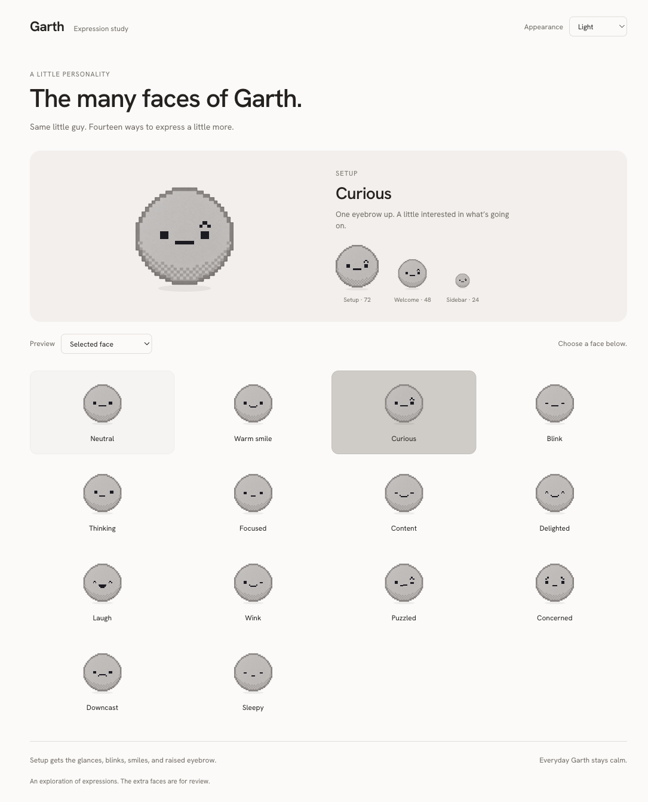

# Hob expression study

This is a review-only spike, outside the shipped app. It reuses the app's body artwork and Hanken font. The extra expressions are deliberately kept here until reviewed.

From the repository root:

```sh
python3 -m http.server 8902 --bind 127.0.0.1
```

Open http://127.0.0.1:8902/design/hob-expressions/.

Choose any of the 14 faces to compare it at setup, welcome, and sidebar sizes. “Setup personality” previews cursor following, idle glances, blinks, smiles, and a raised eyebrow. “Cycle all faces” is for comparing the exploration; it is not app behavior. Appearance can be System, Light, or Dark. Automatic motion respects reduced motion.

The production change enables playful behavior only in `Onboarding.tsx`. Chat's welcome and status mascots keep their existing restrained behavior. No new dependencies or model downloads are needed to view this study.

Big grin and Surprised were removed after review: their exaggerated mouth shapes departed from Hob’s simple expression language. The remaining faces preserve the small square eyes and compact mouth; differences come from the gaze, eyelids, eyebrow, or a small change in the mouth.


