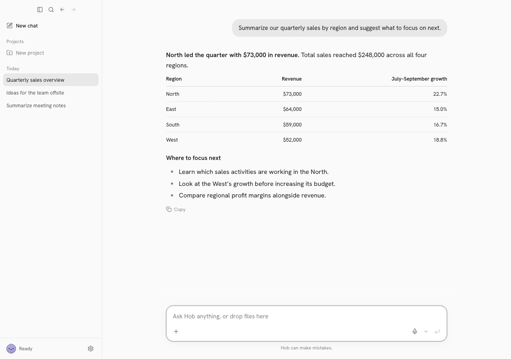
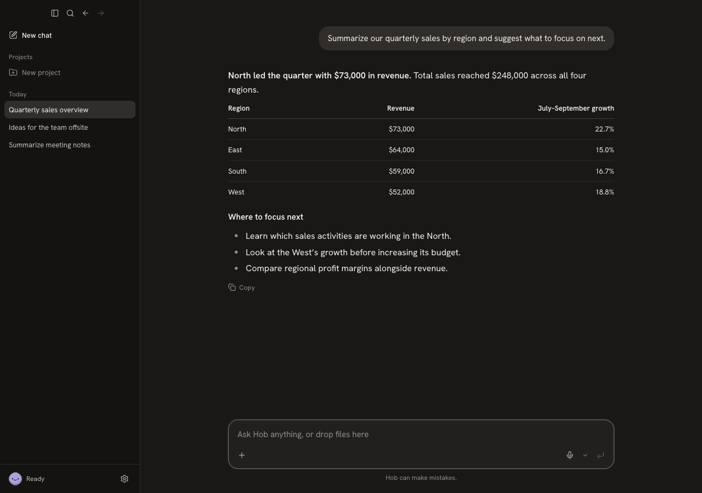

# Hob neutral light palette

Color-only application of the approved light palette, based on the latest merged `main` (`afc1ddf`). The canvas and sidebar share `#FAFAFA`, with the existing divider. Cards, menus, dialogs, and the composer retain white surfaces.

| Before | After | Why |
| --- | --- | --- |
| Paper `#FBFAF9`, sidebar `#F4F3F1` | Both `#FAFAFA` | One neutral canvas, retaining the divider. |
| Surface `#FFFFFF` | `#FFFFFF` | Cards and composer remain white. |
| Ink `#1C1917`, soft ink `#57534E`, muted `#817B75` | `#1C1C1C`, `#575757`, `#818181` | Approved neutral text palette. |
| Line `#E9E6E3`, strong line `#D6D2CD` | `#E7E7E7`, `#D6D6D6` | Neutral borders and dividers. |
| Selection `#E8E5E1`, focus `#8A847F` | `#E8E8E8`, `#888888` | Neutral selected and focus states. |
| Onboarding overrides muted, selected, and hover colors with warm values | Inherits shared muted/selection; hover mixes shared line and surface | Setup and the shared model picker follow the same palette. |
| Warm native startup background and account sign-in page | Approved paper/ink values | Removes hardcoded warm neutrals outside the renderer stylesheet. |

The action/on-action, accent, recording, danger, and chart tokens are unchanged. Both dark-mode CSS blocks are byte-for-byte unchanged. Hanken, font sizes, spacing, layout, radii, shadow declarations, icons, mascot assets/animation, and application behavior are unchanged. No marketing-site or installer redesign is included.

## Screenshots

Captured from the actual Electron UI at 1280 × 900 in disposable fake-model profiles. The conversation is seeded demonstration content, not a real-model result. Transitions/carets are suppressed only for stable captures; production motion is untouched.

| Screen | Light | Dark |
| --- | --- | --- |
| Populated chat and sidebar, focused composer, disabled send | [View](light-chat.png) | [View](dark-chat.png) |
| Onboarding | [View](light-onboarding.png) | [View](dark-onboarding.png) |
| Model picker: selected, hovered, disabled, keyboard focus | [View](light-model-picker.png) | [View](dark-model-picker.png) |
| Settings: selected and hovered navigation | [View](light-settings.png) | [View](dark-settings.png) |
| Menu with a hovered item | [View](light-menu.png) | [View](dark-menu.png) |
| Dialog with a focused field and disabled action | [View](light-dialog.png) | [View](dark-dialog.png) |

[Before: warm chat palette](before-light-chat.png)

## Validation

- Typecheck and production build passed.
- Existing Electron suite: 41 passed, 3 skipped (real-engine and optional screenshot helpers).
- Existing account/OAuth/mascot unit checks: 19 passed.
- Compared 23 rendered states in each theme before and after. Light mode matches all ten approved tokens, preserves protected tokens, and keeps typography, geometry, opacity, and focus treatment dimensions unchanged.
- Dark rendered-state values match exactly. Five of six dark screenshots are pixel-identical; onboarding differs in only 24 pixels by one color-channel level, consistent with raster rounding.
- Confirmed keyboard focus and disabled controls, onboarding/Settings selections, hover states, white surfaces, and the sidebar divider. Scanned renderer/main source for bypassing warm literals; remaining matches belong to the unchanged chart/dark/brand palettes.

Windows/Linux were not run locally. No release was built or published.
