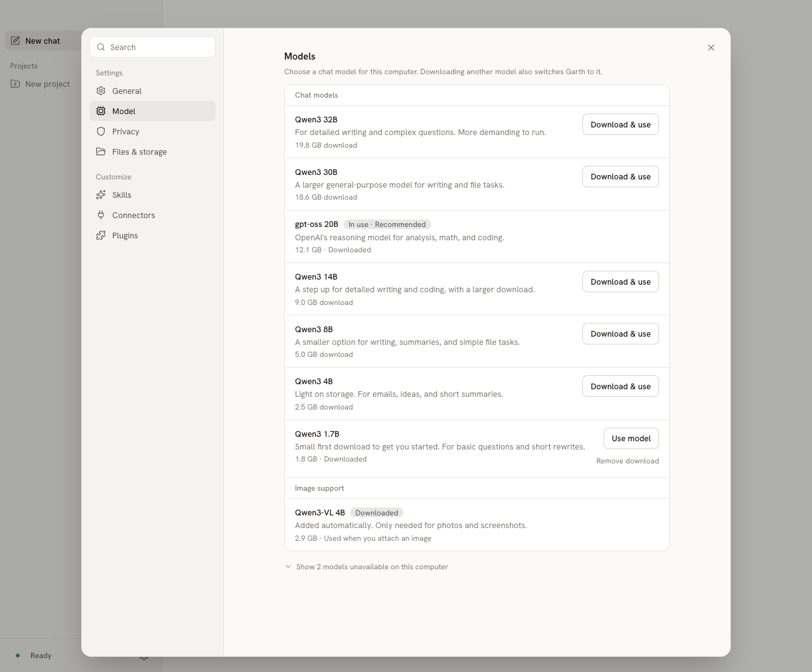
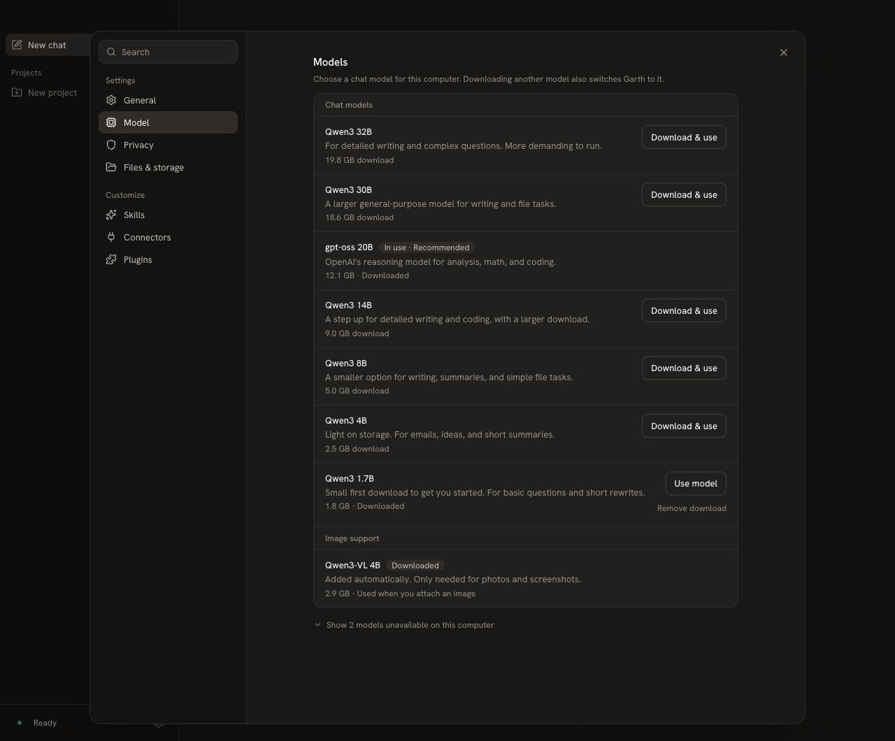
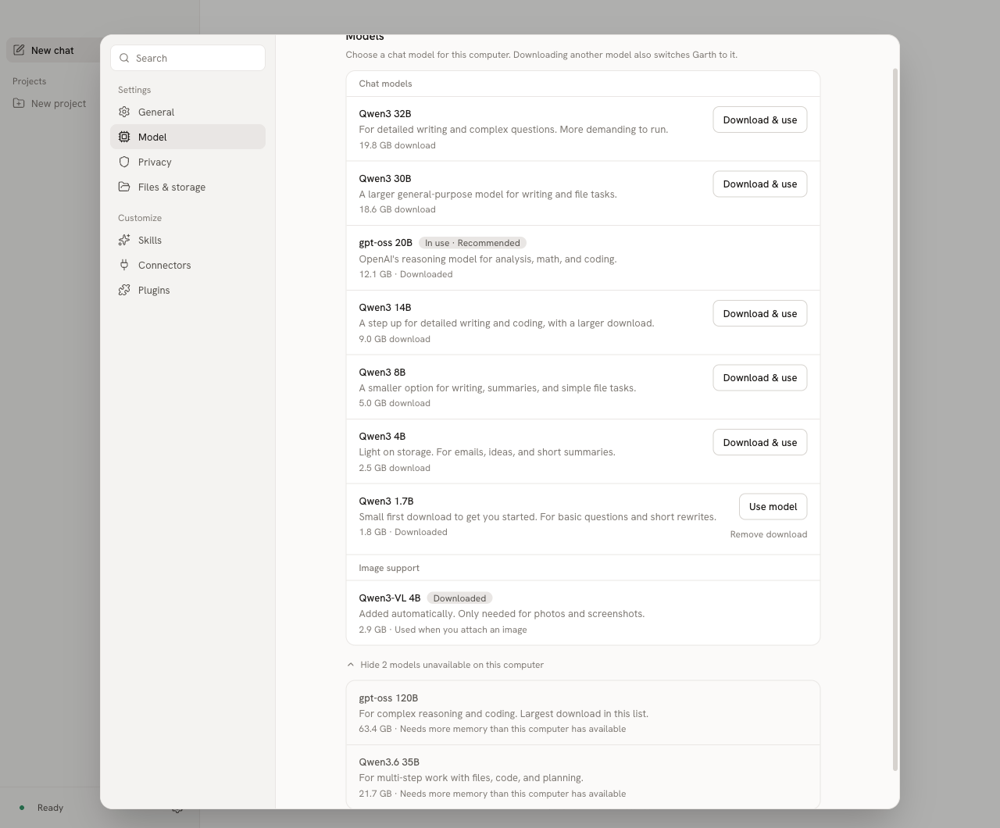
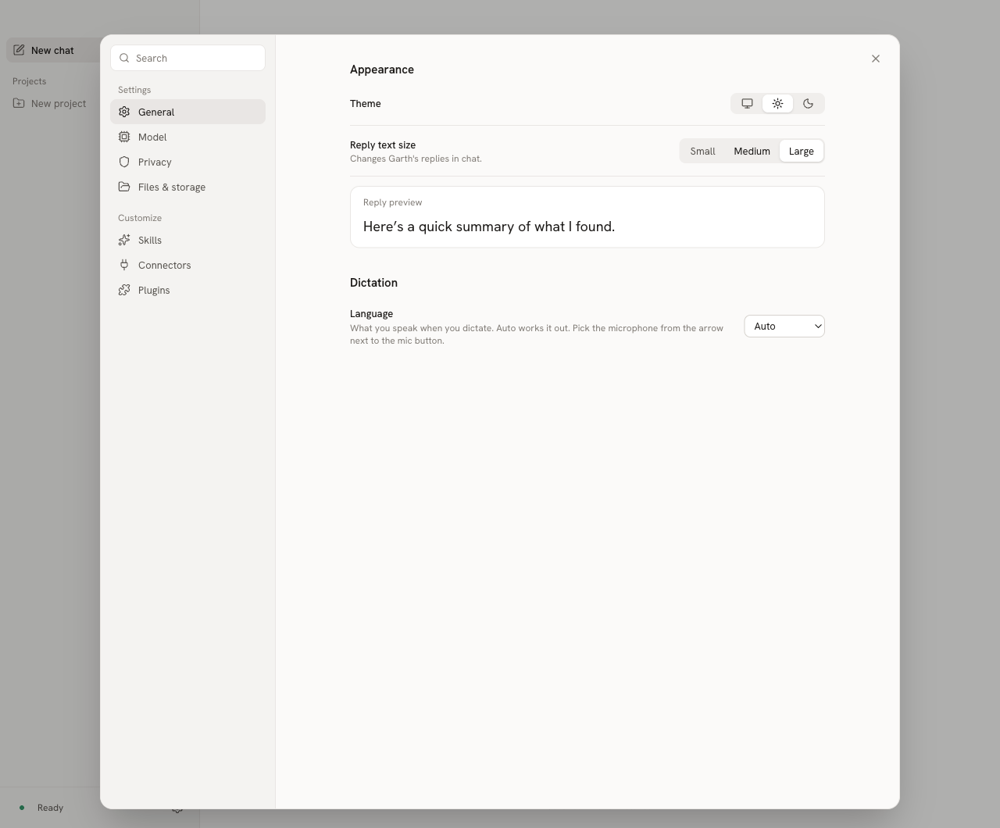
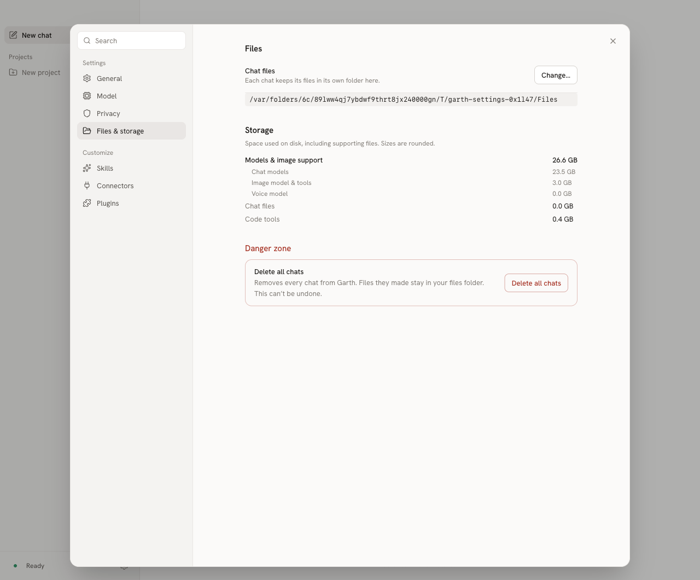

# Settings clarity review

Settings now explains what reply sizing changes, what each model is for, which models this computer cannot run, and what image support downloads automatically. Storage includes the image model and its supporting files.

| Before | After |
| --- | --- |
| Text size changes replies without showing an example. | Reply text size has a live reply preview. |
| Model descriptions and metadata repeat speed claims. | Descriptions explain intended tasks and size tradeoffs; Settings omits the repeated speed labels. |
| Unavailable models are hidden behind a count. | A disclosure shows each model and its memory or estimated-speed restriction. |
| Image support says Ready in a separate card. | The same table shows Downloaded and explains automatic installation and use. |
| Use, Download, and Delete leave the effect implicit. | Use model, Download & use, and Remove download state the action. |
| Models storage excludes image support. | A total and breakdown include chat, image, and voice assets. |

## Preview

These are captures of the actual Electron UI using a disposable test profile and stand-in model data. Model availability and recommendation reflect the test hardware fixture, not Eric's Mac. The storage screenshot uses sparse sample files to represent a realistic footprint without downloading models.

### Models, light

### Models, dark

### Unavailable models

### Reply text size

### Storage

## Model descriptions

| Model | Description |
| --- | --- |
| Qwen3.6 35B | For multi-step work with files, code, and planning. |
| Qwen3 30B | A larger general-purpose model for writing and file tasks. |
| gpt-oss 20B | OpenAI's reasoning model for analysis, math, and coding. |
| Qwen3 8B | A smaller option for writing, summaries, and simple file tasks. |
| Qwen3 4B | Light on storage. For emails, ideas, and short summaries. |
| Qwen3 1.7B | Small first download to get you started. For basic questions and short rewrites. |
| Qwen3 14B | A step up for detailed writing and coding, with a larger download. |
| Qwen3 32B | For detailed writing and complex questions. More demanding to run. |
| gpt-oss 120B | For complex reasoning and coding. Largest download in this list. |

Descriptions give intended uses, not measured performance rankings. They were checked against the official [Qwen3.6](https://huggingface.co/Qwen/Qwen3.6-35B-A3B), [Qwen3 30B](https://huggingface.co/Qwen/Qwen3-30B-A3B), [Qwen3 8B](https://huggingface.co/Qwen/Qwen3-8B), and [gpt-oss](https://huggingface.co/openai/gpt-oss-20b) model cards. Model abilities overlap; the 30B description remains broad.

## Behavior and validation

Image support still downloads automatically after chat is ready. It is only used for attached images; this change does not add an independent install/remove setting. The unavailable-model disclosure preserves the existing picker restrictions.

The app fetches its catalog from `main`, with a bundled fallback. Until this catalog change merges, an online build can still show the old model descriptions. The test preview uses the branch's bundled catalog.

Validated on macOS with typecheck, build, 419 unit tests (3 skipped), and 43 end-to-end tests (1 skipped), including new checks for reply sizing, unavailable models, image states, removal, and storage accounting. Light and dark screenshots were inspected. No real-model speed or quality benchmarks, Windows/Linux run, or signed installer build were performed.
